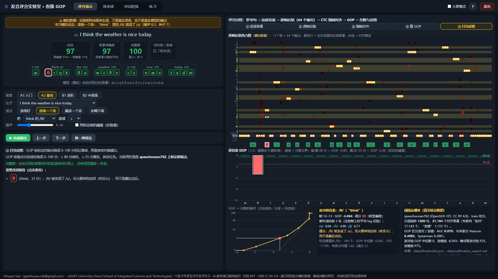
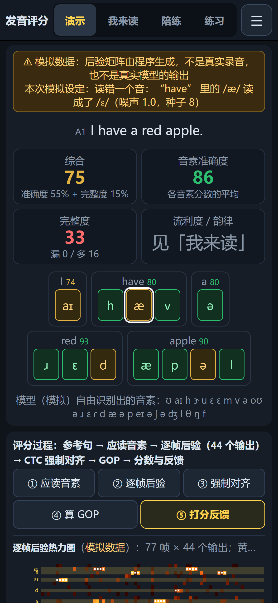
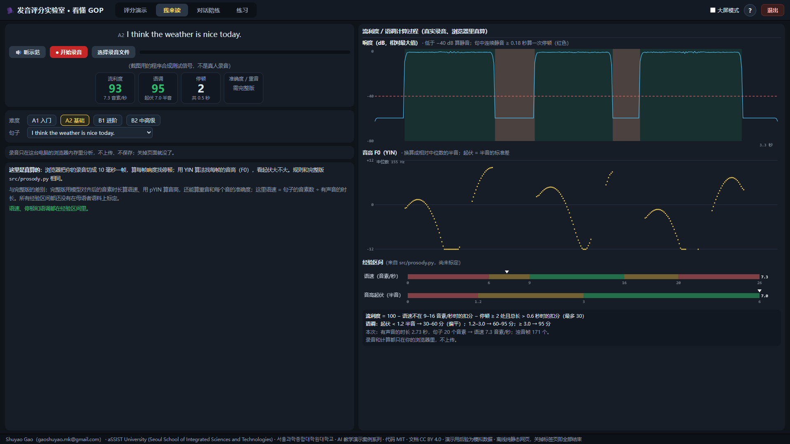
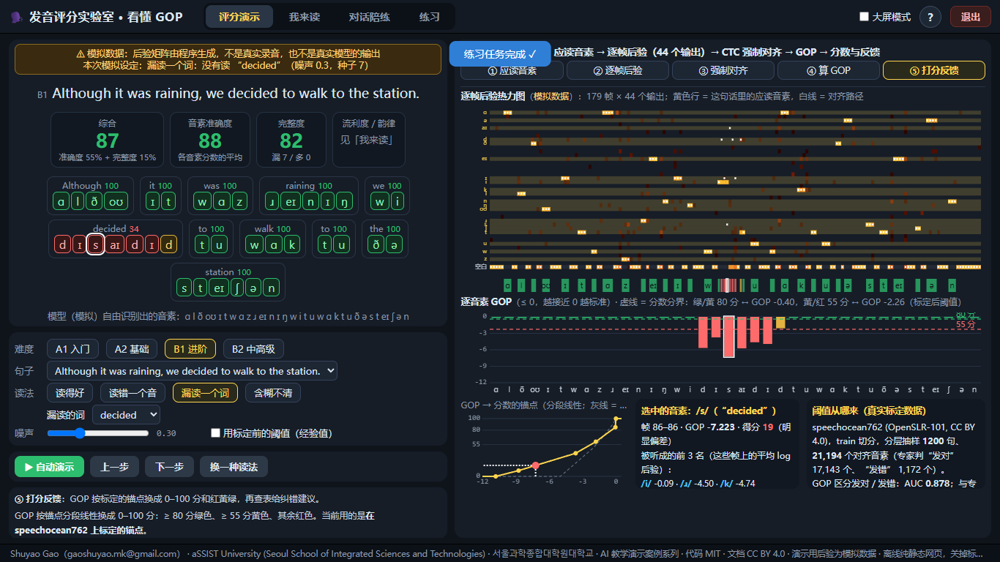

> **AI 教学演示案例 / AI Teaching Demos** 系列

# 发音评分实验室 · 看懂 GOP

**Shuyao Gao**（gaoshuyao.mk@gmail.com）· aSSIST University (Seoul School of Integrated Sciences and Technologies) · 서울과학종합대학원대학교
代码 MIT · 文档与教学素材 CC BY 4.0

一句英文是怎样被打成逐音素的红、黄、绿的？这个网页把发音评分（GOP，Goodness of Pronunciation）拆成 5 步，并把每一步的计算过程摊开给你看：
**应读音素 → 逐帧后验 → CTC 强制对齐 → GOP → 分数与纠错建议**。
另外，你可以用麦克风读一句，浏览器会当场算出流利度（停顿、语速）和语调（音高起伏）。
手机和电脑都能直接打开：不安装、不联网，所有计算都在你的浏览器里。

> ⚠ **关于演示数据**：真实的评分要先用一个约 1.26 GB 的发音模型算出“逐帧后验”，这一步在网页里跑不了。所以「评分演示」里的后验矩阵是**程序生成的模拟数据**，**不是真实录音，也不是真实模型的输出**。页面上每一处都有标注。
> 对齐、GOP、打分、纠错、完整度这些计算都是真的：它们和本仓库 Python 代码的结果一致，由测试锁住。
> 本仓库**不含任何示例录音**。



## 怎么打开（不用安装，也不用联网）

- **手机**：打开在线链接 <https://ShuyaoGao.github.io/pronunciation-gop-lab/>（竖屏）。
- **电脑**：打开同一个在线链接 <https://ShuyaoGao.github.io/pronunciation-gop-lab/>；
  或在 [Releases](https://github.com/ShuyaoGao/pronunciation-gop-lab/releases) 下载 `pronunciation-gop-lab-v1.0.zip`，解压后双击 `index.html`；
  或仓库首页点 **Code → Download ZIP**，解压后双击 `play/index.html`。

Windows 用自带的 Edge 打开，Mac 用 Safari 打开。**一定要先解压**，不要在压缩包里直接双击。用麦克风时，浏览器会先询问是否允许，点“允许”即可；不允许也没关系，其它模式照常能用。

## 怎么用

页面顶部有四个模式标签，打开时默认是「评分演示」，它会自动播放：

| 模式 | 你能做什么 |
|---|---|
| **评分演示** | 19 句参考句，难度 4 档（A1 / A2 / B1 / B2）。读法 4 种：读得好 / 读错一个音 / 漏读一个词 / 含糊不清，读错哪个音、漏哪个词都可以自己选；噪声可以用滑块细调。用「上一步 / 下一步」一步步看，点任意音素看它被听成了什么、得几分、怎么改；还可以切换“标定前 / 标定后”的阈值做对比 |
| **我来读** | 先点「🔊 听示范」（浏览器自带的语音），再录音或选一个本机的录音文件。浏览器会真算停顿、语速和音高起伏，规则和 `src/prosody.py` 相同。录音只在本机内存里分析，**不上传、不保存** |
| **对话陪练** | 离线规则陪练：固定回复模板加 3 条简单纠错规则，**不是 AI 模型**。面板里会显示句子难度估计的每一项（词长、长词占比、句长、音节数） |
| **练习** | 7 项任务清单，跟着做一遍就能看懂评分流程，做完一项自动打勾 |

**评分过程面板**（电脑在右栏；手机在「评分演示」里放在主画面下方，在「我来读」「对话陪练」里从底部按钮全屏打开）：

- **逐帧后验热力图**：44 个输出 × 每 20 毫秒一帧，其中音素 38 个，其余是空白和特殊记号。黄色行是这句话的应读音素，白线是 CTC 对齐路径，下方色条是每个音素分到的帧。
- **逐音素 GOP 柱**：两条虚线是分数分界，绿 / 黄 80 分、黄 / 红 55 分，它们对应的 GOP 值由阈值锚点反算得到。
- **GOP → 分数的锚点曲线**：标定后的锚点和标定前的经验值（灰线）放在一起对比。
- **选中的音素**：被听成的前 3 名、纠错建议，以及这个音在标定集里的统计。
- **阈值从哪来**：标定用的数据集、样本量、AUC 和相关系数。

### 电脑（键盘鼠标）

左右两栏：左栏上方是句子、分数和逐音素打分条，下方是选项、按钮和说明；右栏是评分过程面板。鼠标点音素块、点 GOP 柱、拖滑块；
鼠标停在热力图上会显示那一帧、那个输出的概率；停在按钮上会弹出带动画的小提示。

| 按键 | 作用 |
|---|---|
| 空格 | 播放 / 暂停自动演示 |
| ← / → | 上一步 / 下一步 |
| N | 换一种读法（换随机种子） |
| 1 – 4 | 切换模式 |
| B | 大屏模式（左右比例 45:55 → 35:65，适合投影） |
| H 或右上角 ? | 再看一次操作说明 |

### 手机（触屏，竖屏）

竖屏打开。顶部一行是标题、四个模式标签（演示 / 我来读 / 陪练 / 练习）和 ☰ 菜单（评分过程面板、操作说明、退出）。
「评分演示」里从上往下是：句子和逐音素打分条、热力图和 GOP 柱（紧凑画法，GOP 柱太长时在框内左右滑）、按钮、噪声滑块和阈值开关、说明，整页可以上下滑；
滑块、按钮和音素块都加大到手指能点的尺寸，点热力图的格子会弹出那一帧的概率。
「我来读」「对话陪练」里计算过程面板默认收起：点**底部的「看计算过程面板」**全屏打开，点「返回」关闭；「开始录音 / 停止并分析」是一个大按钮。
横屏时会提示竖屏体验更佳（也可以选择继续）。手机上不需要键盘，第一次打开弹出的说明是触屏图解。





## 课堂上怎么用（推荐顺序，约 20 分钟）

1. **评分演示 · 读得好（4 分钟）**：先讲清楚，发音评分并不是“把语音识别倒过来用”，而是直接用语音识别声学模型的中间结果，也就是每一帧属于各个音素的概率。
2. **一步步看 ① → ⑤（5 分钟）**：重点讲第 ③ 步强制对齐，已经知道“应该读什么”，只需要找它们各自落在哪几帧；再讲第 ④ 步 GOP 公式。
3. **读错一个音 / 漏读一个词（4 分钟）**：看热力图里亮起来的是哪一行。漏读时，强制对齐仍会把那个词的音素硬塞进旁边的几帧，GOP 只能告诉你“读得不好”；要判断是“漏读”而不是“读错”，还得靠“自由识别 + 编辑距离”算完整度。
4. **切换阈值（2 分钟）**：同一个 GOP，标定前后分数不同。阈值来自 speechocean762 上 1,200 句、21,194 个音素的标定，AUC 0.878。
5. **我来读（5 分钟）**：请同学读一句，看停顿和音高曲线；再讨论哪些指标浏览器里能算，哪些必须靠模型。同学也可以在自己手机上打开在线链接一起读。

讨论题：

1. **GOP 为什么 ≤ 0？** GOP = log P(应读音) − log P(这一帧最可能的音)。什么时候正好等于 0？在页面上比较“含糊不清”和“读错一个音”的 GOP 柱，差别在哪里？
2. **阈值为什么要标定？** 标定前后，同一个 GOP 对应的分数差了多少？标定语料是中国学习者的朗读，换成别的口音、别的麦克风，会发生什么？
3. **哪些东西 GOP 看不到？** 漏读、多读、语调太平、重音不对……各要靠什么方法补？

## 它是怎么做的

```
参考句 ──G2P──► 应读音素 ─┐
录音 ──发音模型（wav2vec2 音素 CTC）──► 逐帧后验 [帧 × 44] ─┤
                                   CTC Viterbi 强制对齐 ◄┘ ──► 每个音素的帧区间
       GOP = mean( log P(应读) − log P(最可能) ) ──阈值锚点──► 0–100 分 + 红 / 黄 / 绿 ──► 纠错建议
       自由识别（贪心解码）vs 应读音素 ──编辑距离──► 完整度（漏读 / 多读）
```

- **完整版**（`src/`，Python）：网页界面，加上真实的发音模型 `vitouphy/wav2vec2-xls-r-300m-timit-phoneme`（第三方，Apache-2.0，首次运行时自动下载，约 1.26 GB）、G2P（g2p_en）、librosa 韵律分析、学习档案，以及可选的大模型对话。
- **网页版**（`play/`）：下面这些逐行移植成了 JavaScript，同一个后验矩阵下结果与 Python 一致：
  - `ctc_align.py`、`pronunciation.py` 中的 GOP、贪心解码、编辑距离和综合分；
  - `thresholds.py`、`feedback.py` 的纠错查表；
  - `cefr.py`、`chat_coach.py` 的离线规则；
  - `prosody.py` 的流利度和语调规则。

  19 句参考句的应读音素事先用 g2p_en 2.1.0 算好（`data/g2p_sentences.json`，每句 12–51 个音素）。网页版不支持自由输入句子，自由输入要用完整版。

- **阈值标定**（`data/thresholds.json`、`data/calibration_report.md`，由 `scripts/calibrate_thresholds.py` 生成）：

| 项目 | 数值 |
|---|---|
| 数据集 | speechocean762 (OpenSLR-101, CC BY 4.0) |
| 抽样 | 1,200 句，21,194 个对齐音素 |
| 专家判“发对” / “发错”的音素 | 17,143 / 1,172 |
| GOP 区分发对 / 发错的 AUC | 0.878 |
| GOP 与专家分的 Pearson / Spearman | 0.4892 / 0.3881 |
| CPU 推理用时 | 19.4 分钟 |
| 标定日期 | 2026-06-12 |
| 锚点（GOP → 分数） | 0→100, -0.05→85, -1.811→60, -3.622→40, -8.751→10, -10.807→0 |

  标定语料是中国学习者的朗读，对其它母语背景或录音条件，阈值可能偏移。

- **流利度 / 语调**：用的是经验区间（语速 6 / 9 / 16 / 20 音素每秒，音高起伏 1.2 / 3.0 半音），**还没有在母语者语料上标定**。网页版与完整版有两点不同：
  - 网页版用自己写的 YIN 算音高，完整版用 librosa 的 pYIN；
  - 网页版的语速 = 句子音素数 ÷ 有声音的时长，完整版用模型对齐后的音素时长。

  重音和逐音素准确度需要模型，网页里不算。

- **测试**（`tests/`）：
  - 用模拟后验，对全部 19 句 × 4 种读法、两套阈值，逐项比对 JS 和 Python 的对齐区间、GOP、分数、等级、听成的音、纠错建议、完整度和综合分；
  - CTC 对齐还要在随机矩阵上比对；
  - Python 的 `round` 规则、CEFR 估计、离线陪练回复、流利度 / 语调公式、librosa 停顿检测都和 JS 比对；
  - YIN 在合成音上的精度、页面数据与源文件一致、G2P 分词，也都有测试；
  - 另有浏览器验收：电脑两种分辨率的页面自检、录音链路（合成音和浏览器的假麦克风，不碰真麦克风）、退出按钮；手机四种尺寸（触屏模拟）的场景断言，见下面的命令。



## 想运行完整版或修改

完整版需要 Python 3.11。首次评分时会自动下载发音模型（约 1.26 GB）。

```bash
pip install -r requirements.txt
python src/app.py                      # 打开 http://127.0.0.1:7860

# 重新生成网页数据（应读音素需要 g2p_en）
python -m tools.export_g2p
python -m tools.build --release        # play/data/app_data.js + release/<仓库名>-v<版本>.zip（play/ + 根目录 index.html）

# 重新标定阈值（会下载 speechocean762，约 1.2 GB；CPU 约几十分钟）
python scripts/calibrate_thresholds.py

# 测试（一致性测试需要 Node.js；浏览器验收另需 pip install playwright 和本机已装的 Edge，不下载浏览器）
python -m pytest
GOP_BROWSER_TEST=1 python -m pytest tests/test_browser.py tests/test_mobile.py
python -m tools.browser_check --shots docs/img      # 电脑 1920×1080 / 1366×768：自检、录音链路、退出、截图
python -m tools.mobile_check_gop --shots docs/img   # 手机 390×844 / 414×896 / 360×780 / 768×1024（触屏）+ 电脑两种尺寸：场景断言、截图
```

可选环境变量见 `.env.example`：接 OpenAI 兼容接口的大模型对话，或接商用发音评测接口做对照，都需要你自己的 key。完整版里，评分、TTS、学习档案默认全部在本机运行。

署名、系列名、仓库名都集中在 `credits.json`；改完运行 `python -m tools.fill_credits`，会重新生成 README、CITATION.cff、LICENSE、根目录 index.html 和页面页脚。

## 目录结构

```
index.html                跳转到 play/index.html（GitHub Pages 首页；解压发布包后双击它）
.nojekyll                 让 GitHub Pages 原样发布，不走 Jekyll
play/                     网页（双击 index.html）
  index.html  css/app.css（含手机竖屏样式）
  js/gop_core.js          对齐 / GOP / 打分 / 完整度 / 纠错（移植自 src/）
  js/simulate.js          模拟后验生成器（只用于演示）
  js/prosody.js           停顿、YIN 音高、流利度 / 语调规则
  js/text_tools.js        CEFR 难度估计、离线规则陪练
  js/config.js            名称、档位、颜色
  js/app.js               页面逻辑（含触屏判定、☰ 菜单、全屏面板）
  data/app_data.js        由 data/ 生成的句子、音素、阈值、提示、标定统计
src/                      完整版（Python）：app.py 为入口
data/                     参考句、应读音素、模型词表、阈值、标定报告、纠错提示库
scripts/                  阈值标定脚本、Windows 语音合成脚本
tools/                    构建、导出、浏览器验收（电脑 + 手机）、署名填充
tests/                    一致性测试与页面检查
docs/img/                 截图（电脑和手机）
```

## 常见问题

- **关掉页面后还有程序在跑吗？** 没有。离线版是纯静态网页，关掉标签页就全部结束，不留任何后台进程。右上角（手机在 ☰ 菜单里）的「退出」会先停止计算、录音和朗读，再尝试关闭标签页；浏览器不允许关闭时，会显示“已停止运行”。
- **录音会上传吗？** 不会。录音只在你的浏览器内存里分析，不上传、不保存，页面也不联网。
- **手机上怎么用？** 竖屏打开在线链接；顶部标签切模式，「评分演示」整页往下滑就能看到热力图和 GOP 柱，「我来读」「对话陪练」点底部的「看计算过程面板」。没有给麦克风权限时页面会明确提示，可以改用「选择录音文件」，其它模式不受影响。
- **为什么不直接用真实模型？** 模型约 1.26 GB，网页里跑不动。想看真实打分，请运行完整版。
- **“听示范”没有声音？** 它用的是操作系统自带的语音；有的电脑没有装英文语音，可以在系统设置里添加。

## 测试情况与已知限制

- Microsoft Edge（本机已装版本，通过 Playwright 驱动）：电脑 1920×1080 和 1366×768 跑过页面自检（四种模式、5 个步骤、4 种读法、阈值切换、大屏模式、帮助），录音链路用合成音和浏览器的假麦克风测过，退出按钮测过；手机 390×844、414×896、360×780（DPR 3）、768×1024（DPR 2）用 DevTools 协议模拟触屏跑过场景断言（无横向溢出、一行头部、触控区 ≥ 44px、换一种读法、噪声滑块、阈值开关、面板开合、菜单开合、假麦克风录音、拒绝麦克风时的提示），没有 JS 报错。
- Chrome 与 Edge 内核相同，但没有单独测；Firefox 未测。
- **真手机（iPhone / 安卓）和 Safari 需要在真实设备上确认**，包括麦克风权限和朗读，目前只有模拟器实测。
- G2P 的已知限制：`She likes to read books.` 里的 read 被 g2p_en 标成了过去式读音 /ɹɛd/。页面照实显示，这本身就是一个讲 G2P 局限的例子。

## 许可证与引用

代码 MIT（见 `LICENSE`），文档与教学素材（README、截图、页面文字）CC BY 4.0（见 `LICENSE-docs`），使用请注明出处。引用信息见 `CITATION.cff`（GitHub 页面右侧的 “Cite this repository”）。第三方模型、数据集和依赖的说明见 `THIRD_PARTY.md`。

## AI 辅助开发声明

代码由 Claude Code 辅助编写，经作者审阅。

## English summary

**Pronunciation GOP Lab** is a browser-only teaching demo from the AI Teaching Demos series by Shuyao Gao, aSSIST University (Seoul School of Integrated Sciences and Technologies). It explains how pronunciation is scored phone by phone with GOP (Goodness of Pronunciation): reference phonemes, frame-level phoneme posteriors, CTC forced alignment, GOP, calibrated score thresholds and feedback. Because the real 1.26 GB phoneme model cannot run in a web page, the demo posteriors are **simulated by a program and clearly labelled as such**. The alignment, GOP, scoring, completeness and feedback code is a line-by-line JavaScript port of the Python tool, and tests check that both give the same results. Thresholds come from a calibration on speechocean762 (1,200 utterances, 21,194 phones, AUC 0.878). A microphone mode measures fluency (pauses, speaking rate) and intonation (YIN pitch) in the browser; recordings never leave the device. The page works on phones in portrait (one-row header with a menu, charts scaled to the screen width, large touch targets, a full-screen process panel) as well as on desktops. The full Python version (Gradio UI, real model, G2P, prosody, learning history, optional LLM chat) is included. No recordings are shipped. Code: MIT; docs: CC BY 4.0.
